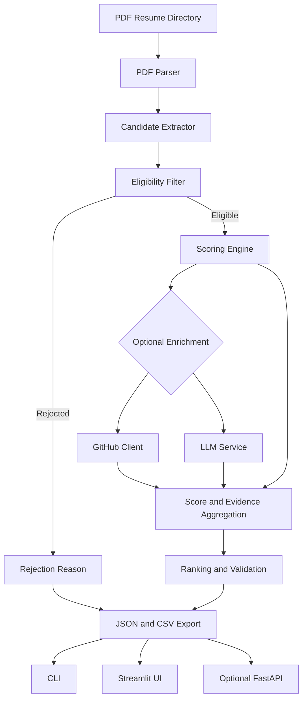

# TalentRank AI

**AI-powered resume screening and ranking for SDE Intern roles**

TalentRank AI processes PDF resumes, applies deterministic eligibility checks, scores eligible candidates against a transparent 100-point rubric, and optionally enriches results with public GitHub data and an LLM-assisted analysis.

The goal is to help reviewers identify candidates who can demonstrate both genuine Python engineering and meaningful AI, LLM, RAG, or agentic-system experience. The system provides ranked results and supporting evidence so that a reviewer can inspect the reasoning rather than relying on a score alone.

> TalentRank AI is a decision-support tool. It should not be used as an automatic hiring decision-maker. Review extracted evidence and candidate context before making a decision.

## Product Screenshots

### Screening dashboard

The dashboard summarizes the batch and provides tabs for eligible, rejected, and failed resumes, along with score and skill filters.


### Candidate score and evidence

The candidate detail view shows the overall score, category-level breakdown, project summary, GitHub status, and extracted strengths.


### Screening configuration

The sidebar lets the reviewer configure input and output directories and enable or disable optional LLM and GitHub enrichment.


## Key Features

- **PDF resume parsing:** Extracts text from PDF files using PyMuPDF.
- **Deterministic eligibility checks:** Requires evidence of Python and meaningful AI or agentic project experience. The LLM does not override these hard filters.
- **Explainable scoring:** Scores eligible candidates out of 100 across five categories and records supporting evidence.
- **GitHub enrichment:** Optionally checks public GitHub signals such as activity and relevant repositories. A missing profile or API failure should not disqualify a candidate.
- **Optional LLM enhancement:** Uses Gemini for supported extraction or qualitative analysis, with structured output validation and deterministic fallback.
- **Batch-level fault tolerance:** A corrupt resume or optional-service failure should not stop the rest of the batch.
- **Multiple interfaces:** CLI as the core workflow, with Streamlit UI and optional FastAPI endpoints.
- **Export:** JSON and CSV outputs for review, audit, and further analysis.

## Architecture

The core screening pipeline is separated from the user interfaces and external services.



### Module responsibilities

| Module | Responsibility |
| --- | --- |
| `src/parser.py` | Extracts text from PDF files and handles file-level parsing errors. |
| `src/extractor.py` | Extracts candidate details, skills, project information, and GitHub references. |
| `src/eligibility.py` | Applies deterministic Python and AI/agentic evidence checks. |
| `src/scorer.py` | Calculates category scores, applies justified penalties, and retains evidence. |
| `src/github_client.py` | Retrieves supported public GitHub signals when enrichment is enabled. |
| `src/llm_service.py` | Provides optional LLM-assisted analysis and validates structured responses. |
| `src/pipeline.py` | Coordinates parsing, eligibility, scoring, enrichment, ranking, and exports. |
| `src/models.py` | Defines structured data models used across the pipeline. |
| `config.py` | Centralizes configuration and scoring thresholds. |
| `main.py` | CLI entry point. |
| `app.py` | Optional Streamlit interface. |
| `api.py` | Optional FastAPI interface. |

## Eligibility Rules

A candidate is eligible only when the resume contains evidence for both requirements:

1. **Python:** Evidence of Python use in a project, internship, work experience, or comparable engineering work.
2. **AI/agentic systems:** Meaningful experience with AI, LLMs, RAG, embeddings, tool calling, agent orchestration, multi-agent workflows, or evaluation pipelines.

A technology appearing only in a skills list should not automatically be treated as proof of project depth. The evidence should be checked in context. Candidates who do not meet the hard requirements are listed as rejected with explicit reasons.

## Scoring Rubric

Eligible candidates are scored out of 100 points.

| Category | Maximum | Evidence considered |
| --- | ---: | --- |
| AI / Agentic / RAG project depth | 40 | Project ownership and depth in agents, retrieval, RAG, orchestration, tool use, state, and evaluation. |
| Python and backend engineering | 30 | Python implementation in projects or experience, APIs, backend services, and related engineering practices. |
| Cloud, deployment, and full stack | 15 | Docker, cloud deployment, CI/CD, and end-to-end application delivery. |
| GitHub activity | 10 | Recent public activity and maintained, relevant repositories. |
| Engineering depth | 5 | Testing, architecture, caching, queues, observability, and concurrency. |
| **Total** | **100** | |

A 5 to 15 point penalty may be applied to shallow AI wrappers or tutorial projects when the evidence supports it. Penalties should be explained, applied once, and reflected consistently in the final score. Missing GitHub data must not be treated as proof of weak engineering.

## Technology Stack

- **Language:** Python 3.11+
- **PDF extraction:** PyMuPDF
- **Data validation:** Pydantic
- **LLM integration:** Gemini, optional
- **GitHub enrichment:** GitHub REST API, optional
- **Interface:** Streamlit, optional
- **API:** FastAPI, optional
- **Testing:** pytest
- **Output:** JSON and CSV

The exact installed dependencies are defined in `requirements.txt`.

## Project Structure

```text
resume-screening/
├── resumes/                  # Input PDF resumes
├── src/
│   ├── models.py              # Pydantic models
│   ├── parser.py              # PDF text extraction
│   ├── extractor.py           # Candidate information extraction
│   ├── eligibility.py         # Deterministic hard filters
│   ├── scorer.py               # Scoring and penalties
│   ├── github_client.py        # Optional GitHub enrichment
│   ├── llm_service.py          # Optional Gemini integration
│   └── pipeline.py             # End-to-end orchestration
├── tests/
│   ├── test_eligibility.py
│   ├── test_scoring.py
│   └── test_parser.py
├── docs/
│   └── images/                 # README screenshots
├── api.py                      # Optional FastAPI app
├── app.py                      # Optional Streamlit app
├── main.py                     # CLI entry point
├── config.py                   # Configuration
├── requirements.txt
├── .env.example
└── README.md
```

## Getting Started

### Prerequisites

- Python 3.11 or later
- PDF resumes in an input directory
- API keys only if you want to enable the corresponding optional integrations

### Installation

```bash
git clone <repository-url>
cd resume-screening

python -m venv .venv
```

Activate the virtual environment:

**Windows PowerShell**
```powershell
.\.venv\Scripts\Activate.ps1
```

If PowerShell blocks activation for the current terminal session, run:

```powershell
Set-ExecutionPolicy -Scope Process -ExecutionPolicy Bypass
.\.venv\Scripts\Activate.ps1
```

**macOS or Linux**
```bash
source .venv/bin/activate
```

Install dependencies:

```bash
python -m pip install --upgrade pip
pip install -r requirements.txt
```

Create a local environment file if the project uses optional API integrations:

**Windows PowerShell**
```powershell
Copy-Item .env.example .env
```

**macOS or Linux**
```bash
cp .env.example .env
```

Add the relevant API keys to `.env`. Never commit `.env` or publish access tokens.

## Running the Application

### Command line

Run screening against a directory of PDF resumes:

```bash
python main.py --input ./resumes --output ./output
```

Disable optional integrations:

```bash
python main.py --input ./resumes --output ./output --no-llm --no-github
```

Enable verbose logs:

```bash
python main.py --input ./resumes --output ./output -v
```

Use `python main.py --help` to confirm the options supported by your current checkout.

### Streamlit interface

```bash
streamlit run app.py
```

Enter the input and output directories, select optional integrations, and start screening from the interface.

### FastAPI interface

If the optional API module is included in your checkout:

```bash
uvicorn api:app --reload
```

The documented endpoints are:

| Endpoint | Purpose |
| --- | --- |
| `GET /health` | Check service health. |
| `POST /screen` | Start a screening run. |
| `GET /results` | Retrieve the latest results. |

Confirm the request schema and endpoint behavior in `api.py`, since they depend on the current implementation.

## Configuration

Configuration is managed through `config.py` and environment variables.

| Variable | Required | Purpose |
| --- | --- | --- |
| `GITHUB_TOKEN` | No | Authenticates GitHub API requests and can increase rate limits. |
| `GEMINI_API_KEY` | No | Enables Gemini-based enhancement. |
| `LLM_MODEL` | No | Selects the configured Gemini model. |

Example scoring weights:

```python
scoring_weights = {
    "ai_project_depth": 40,
    "python_backend": 30,
    "cloud_fullstack": 15,
    "github": 10,
    "engineering_depth": 5,
}
```

Keep the weights aligned with the scoring implementation and test that category scores sum to the pre-penalty total.

## Output

The default output directory is `./output`. The pipeline is designed to export JSON and CSV results.

### JSON

The JSON report should include:

- Batch summary: discovered, parsed, eligible, rejected, and failed counts
- Candidate identity and eligibility status
- Rank and final score
- Category-level score breakdown
- Evidence snippets, matched skills, strengths, and concerns
- GitHub enrichment status
- Rejection reasons for candidates who do not meet eligibility rules

Example structure:

```json
{
  "generated_at": "2026-10-09T10:30:00",
  "batch_summary": {
    "total_discovered": 50,
    "successfully_parsed": 50,
    "eligible_candidates": 47,
    "rejected_candidates": 3,
    "failed_resumes": 0
  },
  "candidates": [
    {
      "rank": 1,
      "candidate_name": "Example Candidate",
      "eligible": true,
      "total_score": 86,
      "score_breakdown": {
        "ai_project_depth": 35,
        "python_backend": 27,
        "cloud_fullstack": 12,
        "github": 8,
        "engineering_depth": 4
      },
      "matched_skills": ["Python", "FastAPI", "Docker"],
      "project_summary": "Built an agentic workflow with retrieval and tool calling.",
      "github_enrichment_status": "success"
    }
  ]
}
```

This is an illustrative schema, not a guarantee that every optional field is present in every run. Check the actual output model in `src/models.py`.

### CSV

The CSV export provides a flattened view of candidate scores and screening outcomes for spreadsheet review.

## Testing

Run the test suite:

```bash
pytest
```

Run specific test modules:

```bash
pytest tests/test_eligibility.py -v
pytest tests/test_scoring.py -v
pytest tests/test_parser.py -v
```

If coverage is configured:

```bash
pytest --cov=src --cov-report=html
```

Important regression tests should verify that:

- Missing or invalid PDFs do not stop the batch.
- Eligibility requires both Python and meaningful AI/agentic evidence.
- Category scores respect their maximums.
- The final score equals the sum of category scores minus any applicable penalty, bounded to 0 through 100.
- Eligible candidates are sorted by descending final score and ranks are reassigned after sorting.
- Missing GitHub profiles or API errors do not create a screening failure or an unsupported penalty.
- Extracted names, skills, summaries, and evidence are grounded in the resume text.

## Reliability and Responsible Use

- **Keep eligibility deterministic:** LLM output must not override hard eligibility rules.
- **Validate structured responses:** Reject malformed LLM output and fall back safely.
- **Isolate failures:** Record per-resume failures and continue processing the remaining batch.
- **Make scoring auditable:** Store category scores, penalties, and evidence separately.
- **Treat GitHub as optional:** Missing, private, or inaccessible profiles should not automatically reduce a candidate's suitability.
- **Protect personal data:** Resumes contain personal information. Keep input files and generated reports private, exclude `.env` and local outputs from version control, and share reports only with authorized reviewers.
- **Keep a human in the loop:** Scores can reflect parsing errors or incomplete evidence. Review resumes before making hiring decisions.

## Known Limitations

- PDF text extraction can vary with layout and document quality.
- Scanned PDFs may require OCR, which is not included in the baseline design.
- Keyword-based extraction can miss context or match a term incorrectly.
- LLM output can be incomplete or inconsistent and requires validation.
- GitHub's public API has rate limits.
- Resume content may contain personal data and must be handled securely.
- Screening scores are heuristic signals, not a validated measure of future job performance.

## Future Improvements

1. Add OCR support for scanned resumes.
2. Evaluate ranking quality against a human-labeled resume set.
3. Add caching for GitHub and LLM responses.
4. Improve name, skill, and project extraction with evidence-level validation.
5. Add score calibration and reviewer feedback.
6. Track score consistency and ranking regressions in automated tests.
7. Add duplicate-resume detection and configurable batch reports.

## License

MIT License, if the repository's `LICENSE` file contains the MIT license. Add a `LICENSE` file before describing the project as MIT-licensed.
# KASPARRO_TalentRank

