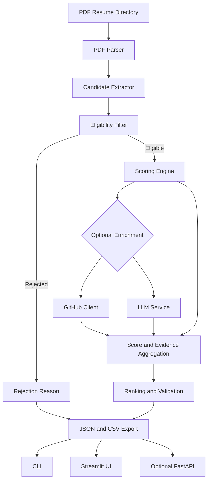

# TalentRank AI

AI-powered resume screening and ranking for SDE Intern roles.

TalentRank AI reads PDF resumes, applies deterministic eligibility checks, and scores eligible candidates against a transparent 100-point rubric. It can optionally add public GitHub data and an LLM-assisted analysis on top of the base result.

The goal is to help a reviewer find candidates who can show both real Python engineering and meaningful experience with AI, LLMs, RAG or agentic systems. The tool returns ranked results with supporting evidence, so the reviewer can inspect the reasoning instead of trusting a score on its own.

> TalentRank AI is a decision-support tool. It should not be used as an automatic hiring decision-maker. Review the extracted evidence and candidate context before making a decision.

**Author:** Suddhasattwa Das, B.Tech CSE, KIIT University (Roll No. 22052861)
**Contact:** suddhasattwadas2016@gmail.com | 8617077929

## Screenshots

### Screening setup

The sidebar takes a zip of resumes, the input and output folders, and switches for the optional LLM and GitHub enrichment.


### Screening dashboard

The dashboard shows the batch summary, tabs for eligible, rejected and failed resumes, a minimum score slider, a skill filter and the ranked candidate list.


### Candidate detail

The detail view shows the overall score, the five category scores, the project summary, the GitHub status and the extracted strengths.


## Key Features

- **PDF resume parsing.** Text is extracted from PDF files with PyMuPDF.
- **Deterministic eligibility checks.** A candidate needs evidence of Python and of meaningful AI or agentic project work. The LLM never overrides these hard filters.
- **Explainable scoring.** Eligible candidates are scored out of 100 across five categories, and the supporting evidence is stored with each score.
- **GitHub enrichment.** Public signals such as activity and relevant repositories can be checked. A missing profile or an API failure does not disqualify anyone.
- **Optional LLM enhancement.** Gemini is used for supported extraction and qualitative analysis, with structured output validation and a deterministic fallback.
- **Batch-level fault tolerance.** A corrupt resume or a failing optional service does not stop the rest of the batch.
- **Multiple interfaces.** The command line is the core workflow, with an optional Streamlit UI and optional FastAPI endpoints.
- **Export.** Results are written as JSON and CSV for review, audit and further analysis.

## Architecture

The core screening pipeline is kept separate from the user interfaces and from external services.



### Modules

| Module | Responsibility |
| --- | --- |
| `src/parser.py` | Extracts text from PDF files and handles file-level parsing errors. |
| `src/extractor.py` | Extracts candidate details, skills, project information and GitHub references. |
| `src/eligibility.py` | Applies the deterministic Python and AI/agentic evidence checks. |
| `src/scorer.py` | Calculates category scores, applies justified penalties and keeps the evidence. |
| `src/github_client.py` | Retrieves supported public GitHub signals when enrichment is enabled. |
| `src/llm_service.py` | Provides optional LLM-assisted analysis and validates structured responses. |
| `src/pipeline.py` | Coordinates parsing, eligibility, scoring, enrichment, ranking and exports. |
| `src/models.py` | Defines the structured data models used across the pipeline. |
| `config.py` | Centralizes configuration and scoring thresholds. |
| `main.py` | CLI entry point. |
| `app.py` | Optional Streamlit interface. |
| `api.py` | Optional FastAPI interface. |

## Eligibility Rules

A candidate is eligible only when the resume shows evidence for both of these:

1. **Python.** Use of Python in a project, internship, work experience or comparable engineering work.
2. **AI or agentic systems.** Meaningful experience with AI, LLMs, RAG, embeddings, tool calling, agent orchestration, multi-agent workflows or evaluation pipelines.

A technology that appears only in a skills list is not accepted as proof of depth. The surrounding context is checked. Candidates who fail a requirement are listed as rejected with explicit reasons.

## Scoring Rubric

Eligible candidates are scored out of 100 points.

| Category | Max | Evidence considered |
| --- | ---: | --- |
| AI / Agentic / RAG project depth | 40 | Project ownership and depth in agents, retrieval, RAG, orchestration, tool use, state and evaluation. |
| Python and backend engineering | 30 | Python implementation in projects or experience, APIs, backend services and related practices. |
| Cloud, deployment and full stack | 15 | Docker, cloud deployment, CI/CD and end-to-end application delivery. |
| GitHub activity | 10 | Recent public activity and maintained, relevant repositories. |
| Engineering depth | 5 | Testing, architecture, caching, queues, observability and concurrency. |
| **Total** | **100** | |

A penalty of 5 to 15 points may be applied to shallow AI wrappers or tutorial projects when the evidence supports it. It is explained, applied once and reflected consistently in the final score. Missing GitHub data is never treated as proof of weak engineering.

## Technology Stack

- Language: Python 3.11+
- PDF extraction: PyMuPDF
- Data validation: Pydantic
- LLM integration: Gemini (optional)
- GitHub enrichment: GitHub REST API (optional)
- Interface: Streamlit (optional)
- API: FastAPI (optional)
- Testing: pytest
- Output: JSON and CSV

Exact dependency versions are listed in `requirements.txt`.

## Project Structure

```text
resume-screening/
|-- resumes/                 input PDF resumes
|-- src/
|   |-- models.py            Pydantic models
|   |-- parser.py            PDF text extraction
|   |-- extractor.py         candidate information extraction
|   |-- eligibility.py       deterministic hard filters
|   |-- scorer.py            scoring and penalties
|   |-- github_client.py     optional GitHub enrichment
|   |-- llm_service.py       optional Gemini integration
|   `-- pipeline.py          end-to-end orchestration
|-- tests/
|   |-- test_eligibility.py
|   |-- test_scoring.py
|   `-- test_parser.py
|-- docs/
|   `-- images/              README screenshots
|-- api.py                   optional FastAPI app
|-- app.py                   optional Streamlit app
|-- main.py                  CLI entry point
|-- config.py                configuration
|-- requirements.txt
|-- .env.example
`-- README.md
```

## Getting Started

### Prerequisites

- Python 3.11 or later and Git
- A folder of PDF resumes
- A Gemini API key and a GitHub token, only if you want those optional features

### Installation

```bash
git clone <repository-url>
cd resume-screening
python -m venv .venv
```

Activate the virtual environment.

Windows PowerShell:

```powershell
.\.venv\Scripts\Activate.ps1
```

If PowerShell blocks the script for the current session, allow it for this terminal only and activate again:

```powershell
Set-ExecutionPolicy -Scope Process -ExecutionPolicy Bypass
.\.venv\Scripts\Activate.ps1
```

macOS or Linux:

```bash
source .venv/bin/activate
```

Install the dependencies:

```bash
python -m pip install --upgrade pip
pip install -r requirements.txt
```

### Environment variables (optional)

Copy the example file and add keys for the integrations you want. The core pipeline runs without any of them.

```powershell
Copy-Item .env.example .env
```

```bash
cp .env.example .env
```

| Variable | Required | Purpose |
| --- | --- | --- |
| `GITHUB_TOKEN` | No | Authenticates GitHub API requests and can raise the rate limit. |
| `GEMINI_API_KEY` | No | Enables Gemini-based enhancement. |
| `LLM_MODEL` | No | Selects the configured Gemini model. |

Never commit `.env` or publish access tokens. Scoring weights and thresholds are set in `config.py`.

## Usage

### Command line

Place the PDF resumes in `resumes/` and run:

```bash
python main.py --input ./resumes --output ./output
```

Without the optional integrations:

```bash
python main.py --input ./resumes --output ./output --no-llm --no-github
```

With verbose logs:

```bash
python main.py --input ./resumes --output ./output -v
```

Run `python main.py --help` to confirm the options in your checkout.

### Streamlit interface

```bash
streamlit run app.py
```

Upload a zip of resumes or enter the input and output folders, choose the optional integrations and click Run Screening.

### FastAPI interface

If `api.py` is present in your checkout:

```bash
uvicorn api:app --reload
```

| Endpoint | Purpose |
| --- | --- |
| `GET /health` | Check service health. |
| `POST /screen` | Start a screening run. |
| `GET /results` | Retrieve the latest results. |

The request schema depends on the current code in `api.py`.

## Output

Reports are written to `./output` as JSON and CSV. The JSON report holds the batch summary, each candidate's rank, final score, category breakdown, evidence, matched skills, GitHub status and any rejection reasons. The CSV is a flattened version for spreadsheet review.

```json
{
  "generated_at": "2026-10-09T10:30:00",
  "batch_summary": {
    "total_discovered": 50,
    "successfully_parsed": 50,
    "eligible_candidates": 47,
    "rejected_candidates": 3,
    "failed_resumes": 0
  },
  "candidates": [
    {
      "rank": 1,
      "candidate_name": "Example Candidate",
      "eligible": true,
      "total_score": 86,
      "score_breakdown": {
        "ai_project_depth": 35,
        "python_backend": 27,
        "cloud_fullstack": 12,
        "github": 8,
        "engineering_depth": 4
      },
      "matched_skills": ["Python", "FastAPI", "Docker"],
      "project_summary": "Built an agentic workflow with retrieval and tool calling.",
      "github_enrichment_status": "success"
    }
  ]
}
```

This schema is illustrative, and optional fields may be missing in a given run. The real output model is in `src/models.py`.

## Testing

```bash
pytest
pytest tests/test_eligibility.py -v
pytest tests/test_scoring.py -v
pytest tests/test_parser.py -v
pytest --cov=src --cov-report=html
```

The last command applies only if coverage is configured. The tests should check that:

- Missing or invalid PDFs do not stop the batch.
- Eligibility requires both Python and meaningful AI or agentic evidence.
- Category scores respect their maximums.
- The final score equals the category total minus any penalty, bounded between 0 and 100.
- Eligible candidates are sorted by descending final score and ranks are reassigned after sorting.
- Missing GitHub profiles or API errors cause no failure and no unsupported penalty.
- Extracted names, skills, summaries and evidence are grounded in the resume text.

## Reliability and Responsible Use

- Eligibility stays deterministic, and malformed LLM output is rejected with a safe fallback.
- Each resume failure is recorded and the rest of the batch continues.
- Scores, penalties and evidence are stored separately so scoring can be audited.
- A missing, private or inaccessible GitHub profile does not lower a candidate's suitability.
- Resumes contain personal data. Keep inputs and reports private, keep `.env` and local outputs out of version control, and share reports only with authorized reviewers.
- Scores can reflect parsing errors or incomplete evidence, so read the resume before any hiring decision.

## Known Limitations

- PDF text extraction varies with layout and document quality.
- Scanned PDFs need OCR, which the baseline design does not include.
- Keyword-based extraction can miss context or match a term incorrectly.
- LLM output can be incomplete or inconsistent and needs validation.
- GitHub's public API has rate limits.
- Scores are heuristic signals, not a validated measure of future job performance.

## Future Improvements

1. Add OCR support for scanned resumes.
2. Evaluate ranking quality against a human-labeled resume set.
3. Cache GitHub and LLM responses.
4. Improve name, skill and project extraction with evidence-level validation.
5. Add score calibration and reviewer feedback.
6. Track score consistency and ranking regressions in automated tests.
7. Add duplicate-resume detection and configurable batch reports.
